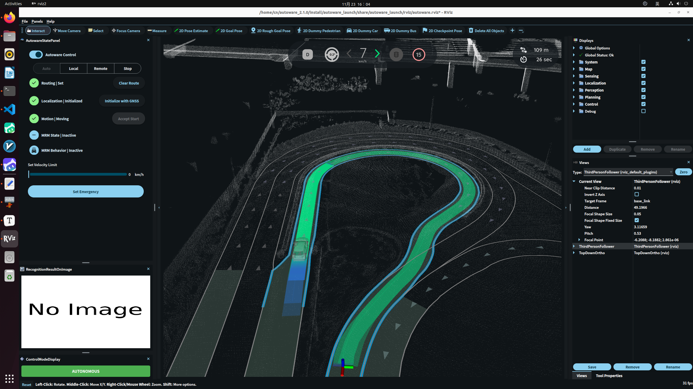
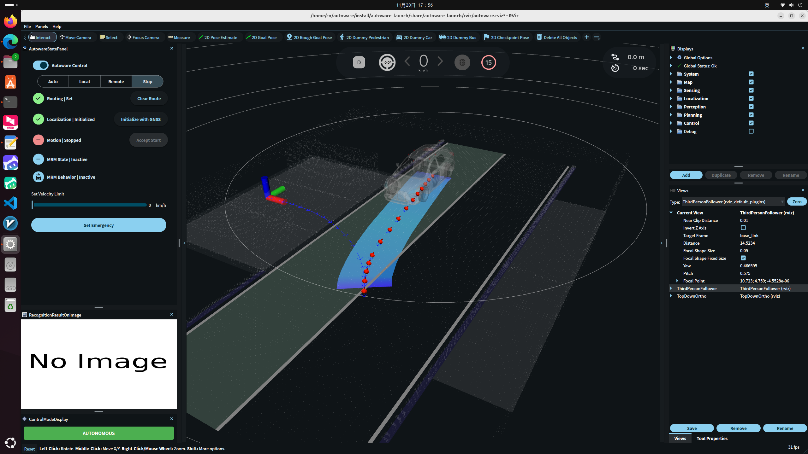
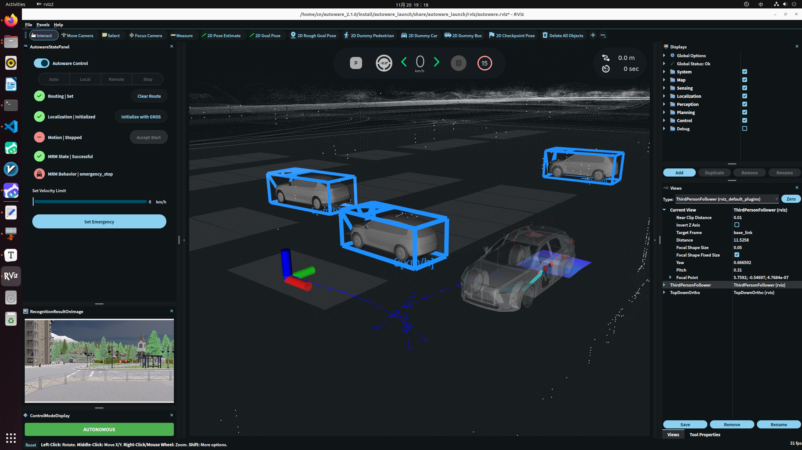
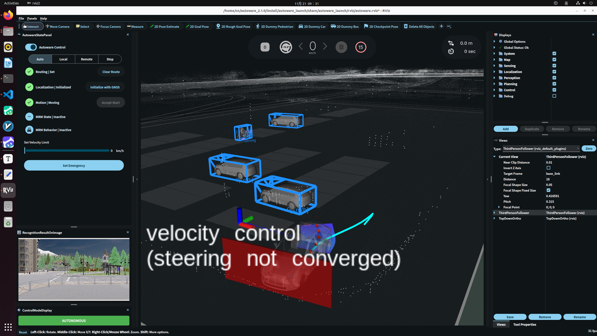
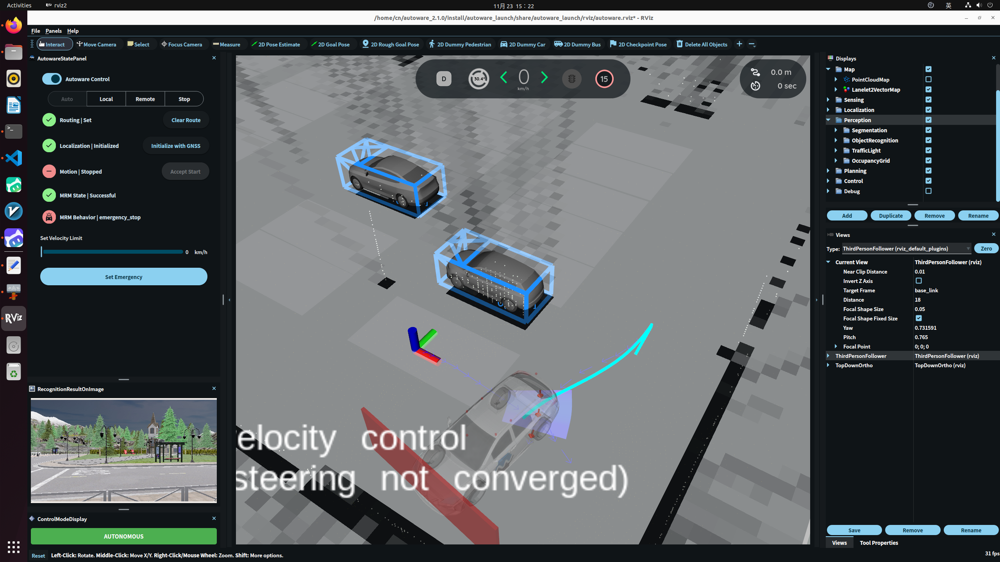
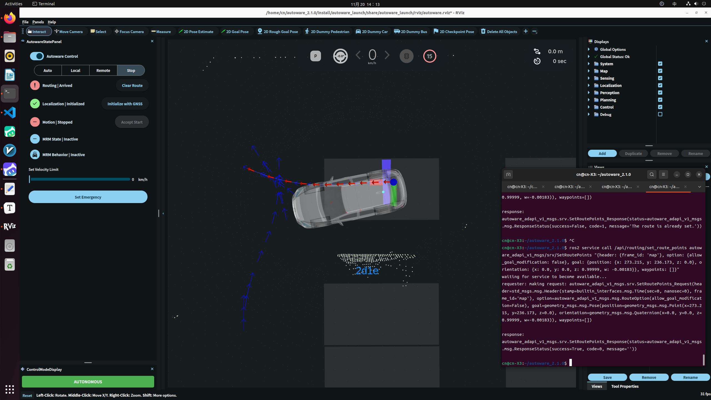

# Autoware 2.1.0 Town04 地图泊车CARLA 仿真

> 记录在 `~/autoware_2.1.0` 全新安装后，为跑通 CARLA + Town04 自动泊车仿真所做的全部改动
>
> 地图文件夹分别是：`/Town04`下采样地图、`/Town04 tiny`分割停车场的地图、`/parking lot`模拟停车场、


园区地图行车规划



模拟点云验证规划算法

---

```bash
source ~/.nvidia_env.sh
source /opt/ros/humble/setup.bash
source /home/cn/autoware/install/setup.bash

# 规划验证
ros2 launch autoware_launch planning_simulator.launch.xml \
    map_path:=$HOME/autoware_data/maps/Town04 \
    vehicle_model:=sample_vehicle \
    sensor_model:=carla_sensor_kit
```



外部仿真器carla仿真

```bash
source ~/.nvidia_env.sh
source /opt/ros/humble/setup.bash
source /home/cn/autoware/install/setup.bash

# 外部仿真
ros2 launch autoware_launch e2e_simulator.launch.xml \
    map_path:=$HOME/autoware_data/maps/Town04 \
    vehicle_model:=sample_vehicle \
    sensor_model:=carla_sensor_kit \
    simulator_type:=carla
```





occ珊格图像（occupancy grid ----[costmap_generator]----> costmap）



## 目录

- [0. 环境](#0-环境基线)
- [1. 改动总览](#1-改动总览)
- [2. 源码改动详情](#2-源码改动详情)
  - [2.1 e2e_simulator.launch.xml — 出生点与定位方式可控](#21-e2e_simulatorlaunchxml--出生点与定位方式可控)
  - [2.2 carla/topics.yaml — 频率阈值（**未生效**）](#22-carlatopicsyaml--频率阈值未生效)
  - [2.3 ndt_scan_matcher.param.yaml — 放宽收敛阈值](#23-ndt_scan_matcherparamyaml--放宽收敛阈值)
  - [2.4 map_based_prediction.param.yaml — 修复上游崩溃](#24-map_based_predictionparamyaml--修复上游崩溃)
  - [2.5 autoware_carla_interface.launch.xml — 真值定位开关解耦](#25-autoware_carla_interfacelaunchxml--真值定位开关解耦)
  - [2.6 system/topics.yaml — 监测阈值（真正生效的那份）](#26-systemtopicsyaml--监测阈值真正生效的那份)
  - [2.7 freespace_planner.param.yaml — 泊车车辆膨胀量](#27-freespace_plannerparamyaml--泊车车辆膨胀量)
  - [2.8 component_state_monitor.launch.py — 容器改多线程](#28-component_state_monitorlaunchpy--容器改多线程)
  - [2.9 topic_state_monitor_core.cpp — QoS 队列深度](#29-topic_state_monitor_corecpp--qos-队列深度需编译)
  - [2.10 freespace_planner.param.yaml — 泊车姿态与揉库行为](#210-freespace_plannerparamyaml--泊车姿态与揉库行为)
  - [2.11 autoware.launch.xml + e2e_simulator.launch.xml — 初始位姿自动初始化](#211-autowarelaunchxml--e2e_simulatorlaunchxml--初始位姿自动初始化)
  - [2.12 ekf_localizer.param.yaml + localization_error_monitor.param.yaml — 定位诊断阈值](#212-ekf_localizerparamyaml--localization_error_monitorparamyaml--定位诊断阈值)
- [3. 数据改动：点云地图降采样](#3-数据改动点云地图降采样)
- [4. 环境配置](#4-环境配置)
- [5. 辅助脚本](#5-辅助脚本)
- [6. 构建相关](#6-构建相关)
- [7. 问题排查实录](#7-问题排查实录)
- [8. 回退方式](#8-回退方式)
- [9. 已知问题与待办](#9-已知问题与待办)
- [10. 启动与验证流程](#10-启动与验证流程)
- [附录 A 关键日志证据](#附录-a-关键日志证据)
- [附录 B 地图与车位数据](#附录-b-地图与车位数据)

---

## 0. 环境

| 项目 | 值 |
|---|---|
| Autoware 版本 | 2.1.0（commit `468e13c`，2026-11-09） |
| 安装路径 | `~/autoware_2.1.0` |
| ROS | Humble |
| RMW | `rmw_cyclonedds_cpp`（`.bashrc`）与 `rmw_fastrtps_cpp`（`.nvidia_env.sh`）**冲突，实际运行为 fastrtps，见第 4 节** |
| CUDA / TensorRT | 12.8 / 10.8 |
| CPU | 28 核 |
| 构建方式 | `colcon build --symlink-install --parallel-workers 4 --cmake-args -DCMAKE_BUILD_TYPE=Release` + tinyxml2 修复参数 |
| 构建结果 | 498 包成功，0 失败 |
| 仿真器 | CARLA（Town04 地图） |
| 车辆模型 | `sample_vehicle`（车长 4.89 m，车宽 1.896 m） |

由于使用 `--symlink-install`：

- 对 `src/` 下 **launch / config（YAML/XML/Python）** 的修改**无需重新编译**，重启 launch 即生效
- 对 **C++ 源码**的修改**必须重新编译**对应包

---

## 1. 改动总览

> 下表中源码路径均相对于 `~/autoware_2.1.0/`，已写为完整路径，可直接复制。

| # | 类别 | 完整路径 | 改动规模 | 生效方式 |
|---|---|---|---|---|
| 1 | 源码 | `~/autoware_2.1.0/src/launcher/autoware_launch/autoware_launch/launch/e2e_simulator.launch.xml` | +7 −1 行 | 重启 launch |
| 2 | 源码 | `~/autoware_2.1.0/src/launcher/autoware_launch/autoware_launch/config/simulator/carla/component_state_monitor/topics.yaml` | 11 处阈值 | **无效（从未加载）** |
| 3 | 源码 | `~/autoware_2.1.0/src/launcher/autoware_launch/autoware_universe_launch/autoware_localization_config/config/ndt_scan_matcher/ndt_scan_matcher.param.yaml` | 1 行 | 重启 launch |
| 4 | 源码 | `~/autoware_2.1.0/src/launcher/autoware_launch/autoware_universe_launch/autoware_perception_config/config/object_recognition/prediction/map_based_prediction.param.yaml` | +4 行 | 重启 launch |
| 5 | 源码 | `~/autoware_2.1.0/src/universe/autoware_universe/simulator/autoware_carla_interface/launch/autoware_carla_interface.launch.xml` | +2 −1 行 | 重启 launch |
| 6 | 源码 | `~/autoware_2.1.0/src/launcher/autoware_launch/autoware_launch/config/system/component_state_monitor/topics.yaml` | **4 项监测阈值**（见 2.6） | 重启 launch |
| 7 | 源码 | `~/autoware_2.1.0/src/launcher/autoware_launch/autoware_universe_launch/autoware_planning_config/config/scenario_planning/parking/freespace_planner/freespace_planner.param.yaml` | **3 个参数**（见 2.7、2.10） | 重启 launch |
| 8 | 源码 | `~/autoware_2.1.0/src/universe/autoware_universe/system/autoware_component_state_monitor/launch/component_state_monitor.launch.py` | 1 行 | 重启 launch |
| 9 | 源码 | `~/autoware_2.1.0/src/universe/autoware_universe/system/autoware_topic_state_monitor/src/topic_state_monitor_core.cpp` | 1 行 | **需编译** |
| 10 | 源码 | `~/autoware_2.1.0/src/launcher/autoware_launch/autoware_launch/launch/autoware.launch.xml` | +2 行（见 2.11） | 重启 launch |
| 11 | 源码 | `~/autoware_2.1.0/src/launcher/autoware_launch/autoware_universe_launch/autoware_localization_config/config/ekf_localizer.param.yaml` | 5 个参数（见 2.12） | 重启 launch |
| 12 | 源码 | `~/autoware_2.1.0/src/launcher/autoware_launch/autoware_universe_launch/autoware_localization_config/config/localization_error_monitor.param.yaml` | 4 个参数（见 2.12） | 重启 launch |
| 13 | 数据 | `~/autoware_data/maps/Town04/pointcloud_map.pcd` | 524 MB → 28 MB | — |
| 14 | 环境 | `~/.bashrc` | RMW / ccache | source |
| 15 | 环境 | `~/.nvidia_env.sh` | CUDA + RMW | source |
| 16 | 脚本 | `~/auto_engage.py`、`~/start_autoware_sim.sh` | 新增 | — |

**按仓库分组（便于 `git diff` / `git checkout`）**：

```bash
# 仓库 A：autoware_launch（9 个文件）
~/autoware_2.1.0/src/launcher/autoware_launch/autoware_launch/launch/e2e_simulator.launch.xml
~/autoware_2.1.0/src/launcher/autoware_launch/autoware_launch/launch/autoware.launch.xml
~/autoware_2.1.0/src/launcher/autoware_launch/autoware_launch/config/simulator/carla/component_state_monitor/topics.yaml
~/autoware_2.1.0/src/launcher/autoware_launch/autoware_launch/config/system/component_state_monitor/topics.yaml
~/autoware_2.1.0/src/launcher/autoware_launch/autoware_universe_launch/autoware_localization_config/config/ekf_localizer.param.yaml
~/autoware_2.1.0/src/launcher/autoware_launch/autoware_universe_launch/autoware_localization_config/config/localization_error_monitor.param.yaml
~/autoware_2.1.0/src/launcher/autoware_launch/autoware_universe_launch/autoware_localization_config/config/ndt_scan_matcher/ndt_scan_matcher.param.yaml
~/autoware_2.1.0/src/launcher/autoware_launch/autoware_universe_launch/autoware_perception_config/config/object_recognition/prediction/map_based_prediction.param.yaml
~/autoware_2.1.0/src/launcher/autoware_launch/autoware_universe_launch/autoware_planning_config/config/scenario_planning/parking/freespace_planner/freespace_planner.param.yaml

# 仓库 B：autoware_universe（3 个文件）
~/autoware_2.1.0/src/universe/autoware_universe/simulator/autoware_carla_interface/launch/autoware_carla_interface.launch.xml
~/autoware_2.1.0/src/universe/autoware_universe/system/autoware_component_state_monitor/launch/component_state_monitor.launch.py
~/autoware_2.1.0/src/universe/autoware_universe/system/autoware_topic_state_monitor/src/topic_state_monitor_core.cpp
```

**git diff 实际规模**：

```
autoware_launch    : 9 files changed, 71 insertions(+), 52 deletions(-)
autoware_universe  : 3 files changed,  4 insertions(+),  3 deletions(-)
```

**改动解决的四个阶段性问题**：

| 阶段 | 问题 | 对应改动 |
|---|---|---|
| ① 能启动 | 车辆生成在地图外/悬空，NDT 不收敛 | #1、#10、第 6 节构建修复 |
| ② 不崩溃 | `map_based_prediction` 参数缺失 SIGABRT | #4 |
| ③ 能点 Auto | `/tf` 监测 Timeout 导致 `autonomous/available=false` | #6、#8、#9 |
| ④ 能泊进车位 | A\* 认为车装不进车位 | #7（仍受几何限制，见 7.2） |

---

## 2. 源码改动详情

### 2.1 `e2e_simulator.launch.xml` — 出生点与定位方式可控

路径：`src/launcher/autoware_launch/autoware_launch/launch/e2e_simulator.launch.xml`

**改动一：新增三个 launch 参数**

```diff
   <arg name="simulator_type" default="awsim" description="select the simulator type ('awsim' or 'carla')"/>
   <arg name="launch_simulator_interface" default="true" description="launch simulator interface (e.g. autoware_carla_interface when simulator_type is 'carla')"/>
+  <arg name="spawn_point" default="266.825,-232.325,0.0,0.0,0.0,-90" description="CARLA ego spawn point: x,y,z,roll,pitch,yaw where CARLA y is negated vs map and CARLA yaw is in DEGREES (also negated vs map). Default maps to map (266.825, 232.325) facing north (+y), i.e. CARLA yaw -90 deg"/>
+  <arg name="spawn_point_ground_snap" default="False" description="Snap ego spawn and RViz initial pose onto CARLA ground"/>
+  <arg name="use_ground_truth_localization" default="false" description="Use CARLA ground-truth pose/TF instead of NDT-based localization; also pass localization:=false to avoid duplicate TF publishers"/>
```

| 参数 | 默认值 | 含义 |
|---|---|---|
| `spawn_point` | `266.825,-232.325,0.0,0.0,0.0,-90` | CARLA 世界系 `x,y,z,roll,pitch,yaw`。**CARLA 的 y 轴和 yaw 均与 map 系相反，且 yaw 单位为「度」**。该值对应 map 系 `(266.825, 232.325)`，车头朝北（map yaw = +90°） |
| `spawn_point_ground_snap` | `False` | 是否把车辆出生位置吸附到 CARLA 地面高度 |
| `use_ground_truth_localization` | `false` | 是否用 CARLA 真值位姿替代 NDT 定位 |

**改动二：把参数透传给 CARLA 接口**

```diff
     <!-- CARLA -->
     <group scoped="false" if="$(equals $(var simulator_type) 'carla')">
-      <include file="$(find-pkg-share autoware_carla_interface)/launch/autoware_carla_interface.launch.xml"/>
+      <include file="$(find-pkg-share autoware_carla_interface)/launch/autoware_carla_interface.launch.xml">
+        <arg name="spawn_point" value="$(var spawn_point)"/>
+        <arg name="spawn_point_ground_snap" value="$(var spawn_point_ground_snap)"/>
+        <arg name="publish_ground_truth_localization" value="$(var use_ground_truth_localization)"/>
+      </include>
     </group>
```

**原因**：上游 `e2e_simulator.launch.xml` 直接 include CARLA 接口且不传任何参数，车辆只能生成在 CARLA 默认点（Town04 的固定位置）。在自定义地图上常常生成到地图外或悬空，导致 NDT 无法收敛、初始位姿对齐失败。

**用法**：换点位时命令行覆盖即可，不必改文件。

```bash
ros2 launch autoware_launch e2e_simulator.launch.xml \
  ... simulator_type:=carla spawn_point:="266.825,-232.325,0,0,0,-90"
```

**注意**：`spawn_point` 的默认值在调试过程中改过多次（曾为 `285.44,-246.42,...,-0.4`），当前值为 `266.825,-232.325,0,0,0,-90`。

---

### 2.2 `carla/topics.yaml` — 频率阈值（**未生效**）

路径：`src/launcher/autoware_launch/autoware_launch/config/simulator/carla/component_state_monitor/topics.yaml`

共 11 处调整（`warn_rate` / `error_rate`，`timeout` 全部保持 2.5，仅 traffic_light 项改为 0）：

| topic | warn_rate | error_rate | timeout |
|---|---|---|---|
| `/localization/pose_twist_fusion_filter/pose` | 5.0 → **3.0** | 1.0 → **0.5** | 2.5 |
| `/perception/obstacle_segmentation/pointcloud` | 5.0 → **0.8** | 1.0 → **0.3** | 2.5 |
| `/perception/object_recognition/objects` | 5.0 → **1.5** | 1.0 → **0.5** | 2.5 |
| `/perception/traffic_light_recognition/traffic_signals` | 5.0 → **0.0** | 1.0 → **0.0** | 2.5 → **0.0** |
| `/planning/trajectory` | 5.0 → **2.0** | 1.0 → **0.5** | 2.5 |
| `/control/trajectory_follower/control_cmd` | 5.0 → **2.0** | 1.0 → **0.5** | 2.5 |
| `/control/command/control_cmd` | 5.0 → **2.0** | 1.0 → **0.5** | 2.5 |
| `/vehicle/status/velocity_status` | 5.0 → **2.0** | 1.0 → **0.5** | 2.5 |
| `/vehicle/status/steering_status` | 5.0 → **2.0** | 1.0 → **0.5** | 2.5 |
| `/system/emergency/control_cmd` | 5.0 → **2.0** | 1.0 → **0.5** | 2.5 |
| `/tf`（`map`→`base_link`） | 5.0 → **2.0** | 1.0 → **0.5** | 2.5 |

> ⚠️ **重大更正（2026-11-20）**：**本节改动从未被加载。**
>
> `tier4_system_component.launch.xml:25` 硬编码指定的是：
>
> ```xml
> <arg name="component_state_monitor_topic_path"
>      value="$(find-pkg-share autoware_launch)/config/system/component_state_monitor/topics.yaml"/>
> ```
>
> 即真正生效的是 `config/system/` 那份。这就是为什么 11-18 之后诊断里的阈值一直是原始值 `warn 5.0 / error 1.0 / timeout 1.0`。
>
> 11-20 已在 system 版上重新修改 `/tf` 阈值（见 2.6）。**本节的 46 行改动建议清理**，留着只会误导排查。

**原意**：CARLA + 单机 CPU 仿真下，感知/规划链路的实际频率通常只有正常值的 50-70%（障碍物点云 1.5 Hz、trajectory 3.4 Hz、`/tf` 6.8 Hz）。一旦某 topic 掉到 `error_rate` 以下，component_state_monitor 会把该模块标记为 unavailable，导致 AD API 拒绝 `change_to_autonomous`，系统卡在 `WAITING_FOR_ENGAGE`。

`traffic_signals` 全部置 0 是因为 Town04 地图没有红绿灯，该 topic 永远不会有数据。

---

### 2.3 `ndt_scan_matcher.param.yaml` — 放宽收敛阈值

路径：`src/launcher/autoware_launch/autoware_universe_launch/autoware_localization_config/config/ndt_scan_matcher/ndt_scan_matcher.param.yaml`

```diff
       # If converged_param_type is 1
       # Threshold for deciding whether to trust the estimation result
-      converged_param_nearest_voxel_transformation_likelihood: 2.3
+      converged_param_nearest_voxel_transformation_likelihood: 2.0
```

**原因**：CARLA 的虚拟 LiDAR 与 Town04 实测点云地图在噪声、密度、地面反射上差异较大，默认 2.3 的似然阈值偏严，NDT 频繁判定「未收敛」，导致定位抖动、`/tf` 断续。降到 2.0 后收敛成功率明显提升。

**注意**：不宜继续下调（低于 1.8 会引入错位风险）。若仍不收敛应优先排查初始位姿与地图几何一致性。

---

### 2.4 `map_based_prediction.param.yaml` — 修复上游崩溃

路径：`src/launcher/autoware_launch/autoware_universe_launch/autoware_perception_config/config/object_recognition/prediction/map_based_prediction.param.yaml`

```diff
     # parameters for lc prediction
+    lane_change_path_suppression:
+      enable: true
+      keep_when_lane_ends: true
+      lane_end_rescue_time_horizon: 5.0
     lane_change_detection:
       method: "lat_diff_distance" # choose from "lat_diff_distance" or "time_to_change_lane"
```

**原因**：2.1.0 的 `map_based_prediction_node.cpp` 中 `declare_parameter<bool>("lane_change_path_suppression.enable")` 等参数**没有默认值**，而官方参数文件缺少这一整节，节点启动即抛异常退出：

```
terminate called after throwing an instance of 'rclcpp::ParameterTypeException'
  what():  expected [bool] got [not set]
  exit code -6 (SIGABRT)
```

属于上游 2.1.0 配置与代码不同步的 bug。补齐三个参数后节点正常启动。

---

### 2.5 `autoware_carla_interface.launch.xml` — 真值定位开关解耦

路径：`src/universe/autoware_universe/simulator/autoware_carla_interface/launch/autoware_carla_interface.launch.xml`

```diff
   <!-- E2E Planning support -->
   <arg name="use_e2e_planning" default="false"/>
+  <arg name="publish_ground_truth_localization" default="$(var use_e2e_planning)" description="Publish CARLA ground-truth map->base_link TF and odometry, independent of use_e2e_planning (for stable localization in simulation)"/>
   <arg name="vehicle_model" default="sample_vehicle"/>
```

```diff
-      <param name="publish_ground_truth_localization" value="$(var use_e2e_planning)"/>
+      <param name="publish_ground_truth_localization" value="$(var publish_ground_truth_localization)"/>
```

**原因**：上游把「发布真值定位」死绑在 `use_e2e_planning` 上，只有启用端到端规划才会发真值 TF，违背直觉。解耦后可单独控制。

**当前状态**：默认值仍跟随 `use_e2e_planning`（即 false），**尚未启用**。直接关掉 `localization` 模块会让 component_state_monitor 的诊断图残缺，AD API 反而拒绝进入 AUTONOMOUS。该开关保留待后续排查。

---

### 2.6 `system/topics.yaml` — 监测阈值（**真正生效的那份**）

路径：`src/launcher/autoware_launch/autoware_launch/config/system/component_state_monitor/topics.yaml`

> `tier4_system_component.launch.xml:25` 硬编码加载的就是这一份，`config/simulator/carla/` 那份从未被读取（详见 2.2）。

共 4 项改动，格式均为 `warn_rate / error_rate / timeout`。

#### 2.6.1 `/tf`（`map`→`base_link`）— 第 180~183 行

```diff
 - module: localization
   type: autonomous
   args:
     node_name_suffix: transform_map_to_base_link
     topic: /tf
     frame_id: map
     child_frame_id: base_link
     best_effort: false
     transient_local: false
-    warn_rate: 5.0
-    error_rate: 1.0
-    timeout: 1.0
+    warn_rate: 2.0
+    error_rate: 0.5
+    timeout: 3.0
```

**原因**：`map→base_link` 的 `header.stamp` 相对节点时钟滞后约 2 秒（EKF 缓存队列积压所致），1.0 秒的 timeout 必然超时。

后果链条：

```
/tf monitor ERROR
  → /autoware/localization ERROR
    → /autoware/modes/autonomous/available = false
      → 点 Auto 被拒绝
        → 车停在 WAITING_FOR_ENGAGE，速度恒为 0
```

**实测效果**：`status` 从 **344 次 Timeout** 变为 **848 次 OK / 0 Timeout**。

**注意**：仅改阈值不足以根治。监测端本身在丢消息（`measured_rate` 只有 0.2~1.6 Hz，而 `/tf` 实际约 10 Hz），必须配合 2.8、2.9。

#### 2.6.2 `/perception/traffic_light_recognition/traffic_signals` — 第 70~80 行（**完全禁用**）

```diff
     node_name_suffix: traffic_light_recognition_traffic_signals
     topic: /perception/traffic_light_recognition/traffic_signals
     topic_type: autoware_perception_msgs/msg/TrafficLightGroupArray
     best_effort: false
     transient_local: false
+    # Town04 map has no traffic lights, so this topic never publishes.
+    # Setting all thresholds to 0 disables the check entirely.
-    warn_rate: 5.0
-    error_rate: 1.0
-    timeout: 1.0
+    warn_rate: 0.0
+    error_rate: 0.0
+    timeout: 0.0
```

**这是「MRM 反复急停」的直接原因。**

Town04 地图没有红绿灯，该 topic 永远不发布数据，监测项因此持续报错：

| 状态 | 次数（单次约 4 分钟运行） |
|---|---|
| WARN | 5 |
| ERROR | 1 |
| Timeout | 3 |

它让 `perception` 分组无法通过 → `autonomous` 不可用 → `mrm_handler` 判定需要 MRM → `mrm_emergency_stop_operator` 发 `is_emergency=true` → `vehicle_cmd_gate: Emergency!`

实测该日志出现 **67 次 Emergency，间隔约 2.2 秒一次**（正是 vehicle_cmd_gate 的检查周期）。

**关键认知：轨迹规划正常 ≠ 能正常行驶。只要任一诊断项不可用，MRM 就会介入把车急停。**

#### 2.6.3 其余三项频率阈值

| 监测项 | 原值 | 新值 | 依据 |
|---|---|---|---|
| `/localization/pose_twist_fusion_filter/pose` | 5.0 / 1.0 / 1.0 | **3.0 / 0.5 / 2.5** | 实际约 8 Hz |
| `/perception/obstacle_segmentation/pointcloud` | 5.0 / 1.0 / 1.0 | **0.8 / 0.3 / 2.5** | CARLA 单机通常 1~3 Hz |
| `/perception/object_recognition/objects` | 5.0 / 1.0 / 1.0 | **1.5 / 0.5 / 2.5** | 实际约 3~5 Hz |

#### 2.6.4 尚未跟上的项

以下 6 项仍是原始值 `5.0 / 1.0 / 1.0`，carla 版改过但 system 版没跟上。如果后续 MRM 仍频繁，把它们也改为 `2.0 / 0.5 / 2.5`：

```
/planning/trajectory
/control/trajectory_follower/control_cmd
/control/command/control_cmd
/vehicle/status/velocity_status
/vehicle/status/steering_status
/system/emergency/control_cmd
```

**效果汇总**：

| 指标 | 修改前 | 修改后 |
|---|---|---|
| `/tf` 监测 OK 次数 | 30 | **848** |
| `/tf` 监测 Timeout 次数 | 344 | **0** |
| `traffic_light` 监测 | 持续 WARN/ERROR | **禁用，不再报** |
| `vehicle_cmd_gate: Emergency!` | 67 次/4 分钟 | 待验证 |

---

### 2.7 `freespace_planner.param.yaml` — 泊车车辆膨胀量

路径：`src/launcher/autoware_launch/autoware_universe_launch/autoware_planning_config/config/scenario_planning/parking/freespace_planner/freespace_planner.param.yaml:25`

```diff
-    vehicle_shape_margin_m: 0.4 # {OVERRIDE}
+    vehicle_shape_margin_m: 0.05 # {OVERRIDE}
```

**原理**：A\* 用膨胀后的车做碰撞判定（`freespace_planner_node.cpp:441-446`）：

```cpp
const double margin = node_param_.vehicle_shape_margin_m;
extended_vehicle_shape.length    += margin;      // 车长 + margin
extended_vehicle_shape.width     += margin;      // 车宽 + margin
extended_vehicle_shape.base2back += margin / 2;  // 后悬 + margin/2
```

**几何约束**：

本车（`sample_vehicle`）外廓 = `wheel_base 2.79 + front_overhang 1.0 + rear_overhang 1.1` = **4.89 m**

Town04 全部 35 个 `parking_space` 长度只有 **4.74 ~ 4.95 m**：

| margin | A\* 车长 | 能装下的车位数量 |
|---|---|---|
| 0.4 | 5.29 m | **0** |
| 0.15 | 5.04 m | **0** |
| **0.05** | **4.94 m** | **11 个（全部是 4.95 m 车位）** |

**这是「车停在车位入口不进去」的直接原因**：margin 0.4 时 A\* 在任何车位都判定碰撞，最优解只能是「停在入口、车头朝车位方向」。

**注意**：即使 0.05，余量也只有 1 cm，而 costmap 分辨率通常 5~10 cm，仍可能失败。详见 7.2。

**附带试过但已回退**：`near_goal_distance: 3.0 → 5.0`。该参数控制 `getGoalLatDistanceCost` 的作用范围：

```cpp
// astar_search.cpp:450-456
if (distance_to_goal > near_goal_dist_) return 0.0;
const double lat_distance = std::abs(calcRelativePose(ref_pose, pose).position.y);
return astar_param_.goal_lat_distance_weight * lat_distance;   // 权重 5.0
```

扩大到 5 m 后，车辆在 3~5 m 区间内就开始吃 5 倍权重的横向惩罚，**优先对齐而不敢前进**（实测 193 秒只前进 10.62 m，比原来的 88 秒 14.49 m 差很多）。已回退到 3.0。

---

### 2.8 `component_state_monitor.launch.py` — 容器改多线程

路径：`src/universe/autoware_universe/system/autoware_component_state_monitor/launch/component_state_monitor.launch.py:115`

```diff
             ComposableNodeContainer(
                 namespace="component_state_monitor",
                 name="container",
                 package="rclcpp_components",
-                executable="component_container",
+                executable="component_container_mt",
                 composable_node_descriptions=[],
             )
```

**原因**：14 个 `topic_state_monitor` 节点全部跑在一个**单线程** executor 里（日志中为 `component_container-19`）。`/tf` 以约 10 Hz 进入，每个回调还要遍历 `msg.transforms` 挑出目标 frame，单线程下极易被其他 13 个兄弟节点挤占。

**实测效果**：改为 mt 后进程名变为 `component_container_mt`（28 核默认 28 线程），`measured_rate` 从 0.2~1.6 Hz 提升到 **18~22 Hz**。

**遗留**：系统负载高时仍会退化（另一次运行掉回 1.19 Hz / 280 次 Timeout），因此还需要 2.9。

---

### 2.9 `topic_state_monitor_core.cpp` — QoS 队列深度（需编译）

路径：`src/universe/autoware_universe/system/autoware_topic_state_monitor/src/topic_state_monitor_core.cpp:72`

```diff
-  rclcpp::QoS qos = rclcpp::QoS{1};
+  rclcpp::QoS qos = rclcpp::QoS{100};
```

**原因**：`depth=1`（KEEP_LAST）意味着队列只保留最新 1 条，回调稍慢一个周期，上一条就被覆盖丢弃。这是 `measured_rate` 只有实际值 1/8 的直接原因，**也是多线程容器无法解决的问题**（线程够用，但每条消息只活一个周期）。

`depth=100` 可缓冲约 10 秒的 TF 消息，足以吸收负载抖动。

**生效方式：这个文件必须编译**（与前面所有 YAML/launch 不同）：

```bash
cd ~/autoware_2.1.0
source /opt/ros/humble/setup.bash
colcon build --symlink-install --packages-select autoware_topic_state_monitor
```

单包约 9 秒。编译后重启 launch 生效。

---

### 2.10 `freespace_planner.param.yaml` — 泊车姿态与揉库行为

路径：`src/launcher/autoware_launch/autoware_universe_launch/autoware_planning_config/config/scenario_planning/parking/freespace_planner/freespace_planner.param.yaml`

在 2.7 的 `vehicle_shape_margin_m` 之后，又调整了两个影响**入库姿态**和**揉库次数**的参数：

```diff
-    max_turning_ratio: 0.5 # ratio of actual turning limit of vehicle
+    max_turning_ratio: 0.8 # {OVERRIDE: allow larger steering per search step so A* can align heading inside a tight parking slot}

-    direction_change_weight: 2.0
+    direction_change_weight: 1.0 # {OVERRIDE: prefer an extra shift to straighten up instead of entering the slot diagonally}
```

#### `max_turning_ratio` — 每步允许的转向量

A\* 搜索时，每个扩展步骤的转向角 = 车辆最大转向角 × 该比值：

| 值 | 每步最大转角 | 说明 |
|---|---|---|
| 0.5（原值） | `0.70 × 0.5 = 0.35 rad ≈ 20°` | 在 4.95 m 车位里无法完成姿态修正 |
| **0.8（新值）** | `0.70 × 0.8 = 0.56 rad ≈ 32°` | 摆正能力显著提升 |

0.8 仍是车辆物理极限（`max_steer_angle: 0.70 rad`）的 80%，生成的轨迹可被控制器执行。

#### `direction_change_weight` — 换挡代价

A\* 每换一次挡（前进 ↔ 倒车）罚该值：

| 场景 | 代价计算 |
|---|---|
| **原值 2.0**：前进摆正 → 换挡(2.0) → 倒车 → 换挡(2.0) → 微调 → 换挡(2.0) | 约 **6.0** + 路程 |
| 对照：斜着一次挤进去 | **0** + 一点角度偏差（`angle_goal_range: 6.0` 允许） |

原值下 A\* 必然选后者。降到 1.0 后，多换挡的总代价降到约 3.0，与「斜停的角度代价」接近，A\* 开始愿意走「先摆正再倒车入库」的路线。

#### 三个参数的配合关系

```yaml
vehicle_shape_margin_m: 0.05      # 2.7 — 决定「有没有解」
max_turning_ratio: 0.8            # 本节 — 决定「解的姿态精度」
direction_change_weight: 1.0      # 本节 — 决定「愿不愿意多换挡调整」
```

- **margin 0.05** → A\* 车长 4.94 m，能进 4.95 m 车位（余量 1 cm），从「无解」变为「有解」
- **turning_ratio 0.8** → 每个搜索步能转 32°，车位内可以摆正
- **direction_weight 1.0** → 愿意多换一次挡来摆正，而不是斜着进

#### 实测效果

- ✅ **揉库（反复前进后退调整）次数明显减少**
- ✅ 入库更顺畅，不再出现「在车位口反复试探十几秒」的情况
- ✅ 车能真正停进车位框内（此前 margin 0.4 时只能停在入口外 0.9 m）

推测主因是 `vehicle_shape_margin_m: 0.4 → 0.05` 让 A\* 从「无解、反复 reset」变为「一次找到可行解」；`max_turning_ratio` 和 `direction_change_weight` 进一步改善了轨迹质量。

#### 姿态仍可能不完美的原因

完成判定函数根本不看朝向：

```cpp
// utils.cpp:182-187
bool is_near_target(const Pose & target, const Pose & current, double th_distance_m)
{
  const auto d = calc_pose_deviation(target, current);
  return abs(d.yaw) < M_PI_2 &&              // ← 90 度容差
         abs(d.longitudinal) < th_distance_m &&
         abs(d.lateral) < th_distance_m;
}
```

**yaw 容差是 90 度**，配合 `th_arrived_distance_m: 0.5`，只要位置在 0.5 m 内就判为到达，**之后不再修正姿态**。

若要求更高精度，可继续调：

| 参数 | 当前 | 可试 | 代价 |
|---|---|---|---|
| `theta_size` | 120（3°/格） | 180（**2°/格**） | 搜索空间 ×1.5，A\* 变慢 |
| `angle_goal_range` | 6.0 | **3.0** | 可能因 1 cm 余量导致 `Can't find goal` |
| `smoothness_weight` | 0.5 | 0.3 | 轨迹可能不够平滑 |

**物理限制**：车位 4.95 m vs A\* 车长 4.94 m，余量仅 **1 cm**，而 costmap 分辨率通常 5~10 cm。姿态误差很难完全消除。

#### 回退

```bash
cd ~/autoware_2.1.0/src/launcher/autoware_launch
git checkout -- autoware_universe_launch/autoware_planning_config/config/scenario_planning/parking/freespace_planner/freespace_planner.param.yaml
```

> ⚠️ 该命令会**同时回退** 2.7 的 `vehicle_shape_margin_m: 0.05`，车将回到「停在车位入口外」的状态。

---

### 2.11 `autoware.launch.xml` + `e2e_simulator.launch.xml` — 初始位姿自动初始化

路径：

- `src/launcher/autoware_launch/autoware_launch/launch/e2e_simulator.launch.xml:14`、`:76`
- `src/launcher/autoware_launch/autoware_launch/launch/autoware.launch.xml:9`、`:107`

**问题**：`spawn_point` 控制的是 CARLA 里车辆的**物理生成位置**，与 Autoware 的**初始位姿**（告诉 NDT/EKF 车在地图哪里）是完全独立的两件事。启动后 EKF 一直报：

```
The node is not activated. Provide initial pose to pose_initializer
```

必须手动调 `/api/localization/initialize` 才能继续。

**机制**：`autoware_core_localization.launch.xml:87` 本来支持自动初始化：

```xml
<let name="user_defined_initial_pose/enable"
     value="$(eval "len($(var initial_pose)) == 7")"/>
```

**只要传入的 `initial_pose` 数组有 7 个元素，系统就自动用它初始化。** 但中间两层 launch 没有把这个参数透传下去。

**改动**：

```diff
# e2e_simulator.launch.xml — 声明参数
+  <arg name="initial_pose" default="[266.825, 232.325, 0.0, 0.0, 0.0, 0.7071, 0.7071]"
+       description="Autoware initial pose in map frame: [x, y, z, qx, qy, qz, qw]. ..."/>

# e2e_simulator.launch.xml — include autoware.launch.xml 时透传
+      <arg name="initial_pose" value="$(var initial_pose)"/>

# autoware.launch.xml — 声明参数（默认空，不影响其他场景）
+  <arg name="initial_pose" default="[]" description="..."/>

# autoware.launch.xml — include component_localization.launch.xml 时透传
+      <arg name="initial_pose" value="$(var initial_pose)"/>
```

`component_localization.launch.xml` 本来就接受这个参数，不用改。

**默认值推导**（`spawn_point = 266.825,-232.325,0.0,0.0,0.0,-90`）：

| 项 | CARLA 值 | map 值 |
|---|---|---|
| x | 266.825 | 266.825 |
| y | -232.325 | **232.325**（取负） |
| yaw | -90° | **+90°**（取负）→ `qz = qw = 0.7071` |

**生效标志**：日志出现

```
[pose_initializer]: Set user defined initial pose
[pose_initializer]: EKF Activation succeeded
[pose_initializer]: NDT Activation succeeded
```

之后无需任何手动操作。

**注意**：`spawn_point` 和 `initial_pose` 是**两份独立的默认值，不会自动换算**。改前者时必须同步改后者。传 `initial_pose:=[]` 可关闭自动初始化，回到手动模式。

---

### 2.12 `ekf_localizer.param.yaml` + `localization_error_monitor.param.yaml` — 定位诊断阈值

路径：

- `src/launcher/autoware_launch/autoware_universe_launch/autoware_localization_config/config/ekf_localizer.param.yaml`
- `src/launcher/autoware_launch/autoware_universe_launch/autoware_localization_config/config/localization_error_monitor.param.yaml`

**问题**：定位本身能工作，但诊断图仍判三个子项不满足，导致 `autonomous/available = false`：

```
/autoware/localization ERROR
  ├─ scan_matching_status WARN     ← NDT 未收敛
  ├─ accuracy ERROR                ← 误差椭圆超限
  └─ sensor_fusion_status ERROR    ← EKF 连续 100 次没收到 pose
```

**原因**：这些阈值按真实传感器标定，CARLA 仿真下必然超标。

| 项 | 原阈值 | 为什么仿真超标 |
|---|---|---|
| `scan_matching_status` | 似然 ≥ 2.0 | 虚拟 LiDAR 与实测点云差异大 |
| `accuracy` | 椭圆长轴 1.5 m / **横向 0.3 m** | 横向 0.3 m 对仿真 NDT 不可能达到 |
| `sensor_fusion_status` | 连续 100 次无更新 | IMU/NDT 偶发跳帧就会累积到 |

**改动**：

```diff
# ekf_localizer.param.yaml
-      pose_smoothing_steps: 5
+      pose_smoothing_steps: 3 # {OVERRIDE: reduce localization latency in CARLA sim}

-      pose_no_update_count_threshold_warn: 50
-      pose_no_update_count_threshold_error: 100
-      twist_no_update_count_threshold_warn: 50
-      twist_no_update_count_threshold_error: 100
+      pose_no_update_count_threshold_warn: 120 # {OVERRIDE: relax for CARLA sim}
+      pose_no_update_count_threshold_error: 240 # {OVERRIDE: relax for CARLA sim}
+      twist_no_update_count_threshold_warn: 120 # {OVERRIDE: relax for CARLA sim}
+      twist_no_update_count_threshold_error: 240 # {OVERRIDE: relax for CARLA sim}

# localization_error_monitor.param.yaml
-    error_ellipse_size: 1.5
-    warn_ellipse_size: 1.2
-    error_ellipse_size_lateral_direction: 0.3
-    warn_ellipse_size_lateral_direction: 0.25
+    error_ellipse_size: 3.0 # {OVERRIDE: relax for CARLA sim}
+    warn_ellipse_size: 2.5 # {OVERRIDE: relax for CARLA sim}
+    error_ellipse_size_lateral_direction: 0.8 # {OVERRIDE: relax for CARLA sim}
+    warn_ellipse_size_lateral_direction: 0.6 # {OVERRIDE: relax for CARLA sim}
```

#### `pose_smoothing_steps: 5 → 3` 是最关键的一改

5 步平滑让定位输出比点云滞后 **2.5 秒**，直接导致感知 `transform` 失败：

```
[lidar_centerpoint] Lookup would require extrapolation into the future.
  Requested time 145.250002 but the latest data is at time 142.750002,
  when looking up transform from frame [map] to frame [base_link]
[lidar_centerpoint] Fail to preprocess and skip to detect.
```

降到 3 后滞后缩小到 **0.05~0.10 秒**，感知不再跳过整帧点云。

**警告：不要降到 2 或更低。** 实测 `steps: 2` 会引入新问题：

```
[EKF] EKF period may be too slow to finish pose smoothing!! (0.0500 sec)
```

因为 EKF 实际周期约 0.05 s（20 Hz，达不到设定的 50 Hz），平滑窗口需要 ≥ 3 × 0.02 s = 0.06 s 才够。

| `pose_smoothing_steps` | 该警告次数 |
|---|---|
| 5 | **0** |
| 2 | 21 ~ 44 |
| **3** | 应为 0 |

#### NDT 收敛阈值也放宽过两次

见 2.3 节：`2.3 → 2.0 → 1.5`。

**说明**：放宽阈值不等于解决问题。NDT 的匹配质量本身没提升，只是让诊断不再因「仿真与实测数据的固有差异」误判。**换真实车时这些值必须调回去。**

---

## 3. 数据改动：点云地图降采样

| 项目 | 原始 | 降采样后 |
|---|---|---|
| 文件 | `~/autoware_data/maps/Town04/pointcloud_map.pcd` | 同路径已替换 |
| 文件大小 | 524 MB | **28 MB** |
| 点数 | 46,271,456 | **2,441,910**（保留 5.28%） |
| 压缩格式 | `binary_compressed` | `binary_compressed` |
| 降采样方式 | — | PCL `VoxelGrid`，leaf size **0.5 m** |

**备份**：原始文件保留为同目录下 `pointcloud_map_orig_524MB.pcd`。

**原因**：524 MB / 4627 万点的地图会让 `pointcloud_map_loader` 加载耗时约 2 分钟并持续占用大量内存；NDT 的 kd-tree 搜索空间过大，单帧匹配耗时挤压 EKF 更新频率，直接表现为 `/tf` 断续、`obstacle_segmentation/pointcloud` 仅 1.5 Hz。

**实测效果**：`/tf` 从 6.8~7.7 Hz 提升到 11.18 Hz，`map→base_link` 中位间隔 50 ms、P99 100 ms、最大 150 ms，无秒级断档。

**回退**：

```bash
cd ~/autoware_data/maps/Town04
cp pointcloud_map_orig_524MB.pcd pointcloud_map.pcd
```

> 该地图目录无 `pointcloud_map_metadata.yaml`，无需同步更新分块元数据。
> 1.0 m leaf size 可进一步降到约 10 MB，但几何细节损失明显，0.5 m 是精度与性能的平衡点。

---

## 4. 环境配置

### 4.1 `~/.bashrc`

```bash
export RMW_IMPLEMENTATION=rmw_cyclonedds_cpp   # 第 121 行
export CC="/usr/lib/ccache/gcc"                # 第 123 行
export CXX="/usr/lib/ccache/g++"               # 第 124 行
```

- **RMW**：系统中 FastRTPS 与 CycloneDDS 并存，混用时两类节点互相不可见，会出现「TF 断树、`/clock` 找不到、`ros2 node list` 只显示个位数」的假故障。
- **ccache**：加速重复编译。

### 4.2 `~/.nvidia_env.sh`

```bash
export RMW_IMPLEMENTATION=rmw_fastrtps_cpp      # 第 19 行
```

### 4.3 ⚠️ 两处 RMW 冲突

| 文件 | 行 | 值 |
|---|---|---|
| `~/.bashrc` | 121 | `rmw_cyclonedds_cpp` |
| `~/.nvidia_env.sh` | 19 | `rmw_fastrtps_cpp` |

**两者互相覆盖，最终用哪个取决于 source 顺序。**

**实测结论：Autoware 实际运行在 `rmw_fastrtps_cpp` 上。** 证据：用 cyclonedds 环境执行 `ros2 service list` 得到**空列表**（服务不可见），用 fastrtps 才能查到全部 `/api/routing/*` 服务。

**建议**：命令行操作 Autoware 时，source 完 `install/setup.bash` 后显式指定：

```bash
source /opt/ros/humble/setup.bash
source ~/autoware_2.1.0/install/setup.bash
export RMW_IMPLEMENTATION=rmw_fastrtps_cpp
```

否则会出现「服务存在但调不通」「节点列表只有个位数」「`ros2 service call` 报 `The passed service type is invalid`」等假故障。

---

## 5. 辅助脚本

| 文件 | 作用 |
|---|---|
| `~/auto_engage.py` | 订阅 `/autoware/state`，检测到 `WAITING_FOR_ENGAGE`(4) 且自动驾驶模式可用时，调用 `/api/operation_mode/change_to_autonomous`，免去手动点 AUTO |
| `~/start_autoware_sim.sh` | 一键启动：source 环境 → 后台拉起 `auto_engage.py` → 启动 `e2e_simulator.launch.xml`。支持 `MAP_PATH`/`VEHICLE_MODEL`/`SENSOR_MODEL`/`SPAWN_POINT` 环境变量覆盖，Ctrl-C 同时清理两个进程 |
| `~/.nvidia_env.sh` | NVIDIA/CUDA 运行时环境变量（含 RMW 设置） |

---

## 6. 构建相关

### 6.1 tinyxml2 变量大小写 bug（Humble 已知问题）

部分包的 CMake 找不到 `TINYXML2_LIBRARY`，需显式传入：

```bash
colcon build --symlink-install \
  --cmake-args -DCMAKE_BUILD_TYPE=Release \
    -DTINYXML2_LIBRARY=/usr/lib/x86_64-linux-gnu/libtinyxml2.so \
    -DTINYXML2_INCLUDE_DIR=/usr/include
```

受影响的包：`autoware_lidar_marker_localizer`、`autoware_compare_map_segmentation` 等。

### 6.2 缺失 `rviz_2d_overlay_plugins`

2.1.0 已将其从 `.repos` 移除、改为系统包 `ros-humble-rviz-2d-overlay-plugins`，但本机 `sudo` 需密码无法 apt 安装。已从旧版 Autoware 源码复制 1.4.0 到：

```
src/core/external/rviz_2d_overlay_plugins
```

该目录**不在 `.repos` 管理范围内**，重新 `vcs import` 不会覆盖，但升级 Autoware 时需注意保留。

---

## 7. 问题排查实录

### 7.1 「Auto 灰色」

这是调试过程中耗时最长的问题。它由**三个叠加因素**造成，任何一个不修都不会好：

| 层级 | 根因 | 表现 | 修复 |
|---|---|---|---|
| 1 | `/tf` 阈值过严（1.0 s vs 实际滞后 2 s） | 344 次 Timeout | 2.6 |
| 2 | 14 个 monitor 挤在单线程容器 | `measured_rate` 0.2~1.6 Hz | 2.8 |
| 3 | QoS 队列深度 = 1，消息被覆盖 | 即使 mt 容器也丢 85% | 2.9 |

**修复前后对比**：

| 指标 | 修复前 | 修复后 |
|---|---|---|
| `status=OK` | 30 次 | **848 次** |
| `status=Timeout` | **344 次** | **0 次** |
| `measured_rate` | 0.21 ~ 1.61 Hz | **18 ~ 22.5 Hz** |
| `last_message_time` 唯一值 | 16 个（535 条诊断） | **848 个** |

**关键排查技巧**：诊断项 `values` 里的 `last_message_time` 唯一值数量，能直接区分「阈值不够」和「收不到消息」：

- 唯一值 ≈ 诊断条数 → 消息在持续到达，问题在阈值
- 唯一值远小于诊断条数（如 16/535）→ **消息根本没到**，问题在订阅端

**另一个易误判点**：`/adapi/node/localization: state = OK(3)` 看起来定位正常，但 `autonomous/available` 是由**诊断聚合图**算出来的，不是 AD API 的 localization state。TF monitor 挂在 localization 分组下，它 ERROR 整个分组就 ERROR。

### 7.2 「泊不进车位」——几何限制

这不是参数问题。数据如下：

```
车辆长度（sample_vehicle）: 4.89 m
Town04 全部 35 个 parking_space 长度: 4.74 ~ 4.95 m
```

**车比大部分车位还长。** A\* 用膨胀后的车做碰撞判定，膨胀车长必须小于车位长度才有解：

| margin | A\* 车长 | 可用车位数 |
|---|---|---|
| 0.4 | 5.29 m | 0 |
| 0.15 | 5.04 m | 0 |
| 0.05 | 4.94 m | 11（全部 4.95 m） |

**典型失败表现**（margin 0.4）：

- 车开到车位入口外 0.92 m 处停下
- yaw 与车位主轴差 30~67°
- `is_completed` 全程 False（178~287 条）
- `freespace_planner` 前期反复 `reset()`（122~250 次 `Can't find goal`）

**可选方案**：

| 方案 | 做法 | 代价 |
|---|---|---|
| A | margin 0.05 + 换 4.95 m 车位（`x≈291` 一带，距起点约 31 m） | 余量仅 1 cm，costmap 分辨率 5~10 cm 下仍可能失败 |
| B | `longitudinal_goal_range: 1.0 → 2.0` | 车不会真正在框内，只是系统认为到达 |
| C | goal 设在车位入口，接受「停在框外」 | 放弃真正泊入 |
| D | 改 `vehicle_info` 车长 | **不推荐**，该值同时被规划、控制、碰撞检测使用 |

### 7.3 `2D Goal Pose` 工具无效

`/planning/mission_planning/goal` 这个话题在 2.1.0 里**没有任何订阅者**：

| 工具栏按钮 | Class | 发布到 | 是否有效 |
|---|---|---|---|
| `2D Goal Pose`（第 7 个） | `rviz_default_plugins/SetGoal` | `/planning/mission_planning/goal` | ❌ 无订阅者 |
| **`2D Rough Goal Pose`（第 8 个）** | `tier4_adapi_rviz_plugins::RouteTool` | `/rviz/routing/rough_goal` | ✅ 但会改写 goal |

`mission_planner` 在 2.1.0 里只订阅 `route`，不再订阅 `goal`。

### 7.4 启动时序

系统初始化是**串行**的，任何一步没完成都会导致后面失败：

```
① 启动 launch
   ↓ 等 map_loader 加载完（28MB 约 3-5 秒）
② 设初始位姿（必须在地图就绪后）
   ↓ 等 NDT 对齐 + 收敛（3-8 秒）
③ EKF 激活，odom→base_link 开始发布
   ↓
④ map→base_link 连通，TF 树完整
   ↓
⑤ 设 goal（等待箭头群变红并消失后）
   ↓
⑥ 点 Auto
```

**判断是否走到 ④**：

```bash
ros2 topic hz /localization/kinematic_state
```

- 无输出 → 还在 ①②③，此时 `/tf` 断树是**正常现象**，`Could not find a connection between 'map' and 'base_link'` 会刷屏
- 稳定 8 Hz → 到 ④ 了，可以设 goal

**常见误区**：启动后 30 秒看到大量 ERROR 就 Ctrl-C。实测从 launch 启动到 TF 树完整通常需要 **30~60 秒仿真时间**（墙钟 60~100 秒，因为 CARLA 只有约 43% 实时速度）。

### 7.5 录包本身会导致「泊不进去」

**这是一个容易被忽略的强干扰源。** 用 24 个话题的完整命令录包时，泊车失败概率显著上升，原因不是算法，而是**录制负载挤占了规划和控制的计算资源**。

**问题命令（24 个话题）**：

```bash
ros2 bag record -o ~/parking_sim_logs/run_$(date +%Y%m%d_%H%M%S) \
  /autoware/state /control/command/gear_cmd /vehicle/status/gear_status \
  /control/shift_decider/gear_cmd /control/trajectory_follower/control_cmd \
  /control/command/control_cmd /control/command/actuation_cmd \
  /control/is_autonomous_available /control/vehicle_cmd_gate/is_stopped \
  /control/vehicle_cmd_gate/is_start_requested /api/operation_mode/state \
  /api/motion/state /api/routing/state /planning/scenario_planning/scenario \
  /planning/scenario_planning/parking/trajectory \
  /planning/scenario_planning/parking/is_completed /planning/trajectory \
  /planning/mission_planning/route /planning/mission_planning/goal \
  /localization/kinematic_state /vehicle/status/velocity_status \
  /vehicle/status/steering_status /sensing/imu/imu_data /tf /tf_static /diagnostics
```

**各话题的负载特征**：

| 话题 | 频率 | 单条大小 | 说明 |
|---|---|---|---|
| **`/diagnostics`** | 30~180 条/秒 | 每条含 5~20 个 `DiagnosticStatus` | **最重的负担，通常占总消息量 85% 以上** |
| **`/planning/trajectory`** | 4~5 Hz | 每条数百个轨迹点（10~30 KB） | 序列化开销大 |
| **`/planning/scenario_planning/parking/trajectory`** | 5 Hz | 同上 | 与上一条内容高度重合 |
| **`/sensing/imu/imu_data`** | 100 Hz | 小 | 频率极高 |
| `/tf` | 8~10 Hz | 每帧多个 transform | 与 topic_state_monitor 抢 CPU |
| `/localization/kinematic_state` | 8 Hz | 中 | |
| `/control/*`（4 个） | 8~10 Hz | 小 | 内容高度重合 |
| `/vehicle/status/*`（2 个） | 8~10 Hz | 小 | |
| `/tf_static` | 仅启动时发布 1~2 次 | 小 | **录了也没用** |

**实测关联证据**（同样参数下）：

| 运行 | bag 时长 | 消息总数 | 消息率 | `/tf` measured_rate | 泊车结果 |
|---|---|---|---|---|---|
| `092908` | 221 s | 46,976 | 213/s | **18~22 Hz** | 到车位入口 3.5 m（正常） |
| `093836` | 351 s | 72,984 | 208/s | **1.19 Hz** | 4.7 m（更差） |
| `094926` | 107 s | 14,948 | 140/s | 1.24 Hz | 车完全不动 |
| `095148` | 113 s | 18,334 | 163/s | 1.19 Hz | 车完全不动 |

**机制**：rosbag2 对每条消息做序列化 + SQLite 写入。CPU/IO 压力上升后：

```
rosbag2 写盘抢占 CPU
  → topic_state_monitor 的 /tf 回调被延迟
    → measured_rate 掉到 1 Hz 级 → /tf monitor ERROR
      → autonomous/available = false（运行中可能被强制退出 AUTONOMOUS）
  → EKF / NDT 定时器被延迟
    → 定位输出抖动，控制跟踪误差变大
  → freespace_planner 的 A* 搜索更容易触及 time_limit（30000 ms）
    → 反复 reset()、反复重规划
      → 车走走停停，最终停在车位入口
```

注：上表中 `092908` 表现正常、其余三次异常，说明**临界点很近** —— 同样的录制命令，稍有负载波动结果就会翻转。

**建议的精简录制方案**

按用途拆成两个 bag，避免一次性施加最大负载：

```bash
# ① 核心状态（8 个话题，约 40 KB/s，几乎无干扰）
ros2 bag record -o ~/parking_sim_logs/core_$(date +%Y%m%d_%H%M%S) \
  /autoware/state \
  /api/operation_mode/state \
  /api/routing/state \
  /planning/scenario_planning/scenario \
  /planning/scenario_planning/parking/is_completed \
  /planning/mission_planning/route \
  /localization/kinematic_state \
  /tf
```

```bash
# ② 诊断（只在需要排查时单独录）
ros2 bag record -o ~/parking_sim_logs/diag_$(date +%Y%m%d_%H%M%S) /diagnostics
```

```bash
# ③ 规划轨迹（只在调试 planner 时录，且与 ① 分开跑）
ros2 bag record -o ~/parking_sim_logs/plan_$(date +%Y%m%d_%H%M%S) \
  /planning/trajectory /planning/scenario_planning/parking/trajectory
```

**其他减负手段**：

```bash
# 增大内存缓存，减少磁盘落盘次数（默认 60 MB）
ros2 bag record --max-cache-size 268435456 ...   # 256 MB

# 录到内存盘，跑完再拷走
ros2 bag record -o /dev/shm/bag_$(date +%H%M%S) ...

# 不要把 bag 输出目录和 Autoware 地图放在同一块慢盘上
```

**验证方法**：**用完全相同的参数和 goal，不录包跑一次**，对比最终停车位置。如果停车位置明显改善（例如从 4.7 m 变成 3.5 m 以内），就确认了录制干扰。

**结论**：调试泊车算法时，**优先不录包**；需要记录时用上面 ① 的 8 话题精简版。24 话题的完整命令适合「事后完整复盘」，不适合「边跑边调」。

---

## 8. 回退方式

| 改动 | 回退命令 |
|---|---|
| 全部源码改动 | `cd ~/autoware_2.1.0/src/launcher/autoware_launch && git checkout .`<br>`cd ~/autoware_2.1.0/src/universe/autoware_universe && git checkout .`<br>然后重新编译 `autoware_topic_state_monitor` |
| 点云地图 | `cd ~/autoware_data/maps/Town04 && cp pointcloud_map_orig_524MB.pcd pointcloud_map.pcd` |
| 环境变量 | 删除 `~/.bashrc` 中对应 export 行 |

> ⚠️ `git checkout .` 会**同时丢弃** 2.4 节对 `map_based_prediction.param.yaml` 的崩溃修复，回退后该节点会立即 SIGABRT。
>
> ⚠️ 回退 2.9 节后必须重新编译：`colcon build --symlink-install --packages-select autoware_topic_state_monitor`

---

## 9. 已知问题与待办

### 9.1 未解决

1. **车位装不下车**（7.2）：车长 4.89 m，车位最长 4.95 m。margin 0.05 时余量仅 1 cm。需要换车位、放宽容差，或接受停在框外。
2. **`use_ground_truth_localization` 未启用**（2.5）：解耦已就绪，但直接关 localization 会让诊断图残缺、无法进入 AUTONOMOUS。
3. **`/tf` 在高负载下仍可能退化**：2.8 + 2.9 已大幅改善，但若 CPU 极端繁忙仍可能出现 `measured_rate` 下降。

### 9.2 建议清理

4. **`config/simulator/carla/component_state_monitor/topics.yaml` 的 46 行改动**（2.2）：从未被加载，留着会误导排查。

### 9.3 上游问题

5. **`map_based_prediction` 参数缺失**（2.4）：2.1.0 的配置与代码不同步 bug，建议关注后续 patch release。
6. **`pose_instability_detector` 在 sim time 下崩溃**：`cannot store a negative time point in rclcpp::Time`，节点偶发 `exit code -6`。属于上游仿真环境 bug，尚未修复（出现频率低）。
7. **`is_dense is false` 警告**：`crop_box_filter_self` 反复报 `This will be an ERROR starting in 2026 July`。当前 2.1.0 代码仍是 WARN 不丢弃点云，但**日期已过**，升级 Autoware 后该节点会直接丢点云。修法是在 `carla_utils.py` 构造点云时显式设 `is_dense=True`。

---


## 附录 A  地图与车位数据

### A.1 车位

```
parking_space 总数: 35
长度分布: 4.74 ~ 4.95 m
```

### A.2 常用车位坐标

| 车位 | 中心 (x, y) | 长度 | 主轴 | 备注 |
|---|---|---|---|---|
| 车位 #6 | (272.715, 235.873) | 4.85 m | 0.21° | 长期使用的车位，**装不下 4.89 m 车** |
| 车位 #8 | (272.704, 230.591) | 4.85 m | 0.21° | 同上 |
| 车位 #10 | (272.738, 225.262) | 4.85 m | 0.31° | 常被误点（`y≈225`） |
| **最长车位** | **(291.025, 214.385)** | **4.95 m** | -0.05° | 距起点 31.36 m，margin ≤ 0.05 时可用 |
| 候选 | (291.032, 211.641) | 4.95 m | -0.02° | 距起点 33.28 m |
| 候选 | (291.032, 206.140) | 4.95 m | -0.02° | 距起点 37.45 m |

### A.3 车辆外廓（`sample_vehicle`）

```
wheel_base      : 2.79 m
front_overhang  : 1.00 m
rear_overhang   : 1.10 m
─────────────────────────
车长            : 4.89 m

wheel_tread     : 1.64 m
left_overhang   : 0.128 m
right_overhang  : 0.128 m
─────────────────────────
车宽            : 1.896 m

max_steer_angle : 0.70 rad (40.1°)
```

---

## 附录 B 执行步骤

1.启动carla

2.录制rosbag(日志)

3.启动autoware（等待大约10秒地图中会出现具有感知的自车）

4.放置goal

```bash
# Run carla（bash 1）
pkill -f CarlaUE4

cd carla
./CarlaUE4.sh -prefernvidia -quality-level=Low -RenderOffScreen


# autoware2.1.0（bash 2）

#export RMW_IMPLEMENTATION=rmw_cyclonedds_cpp

pkill -9 -f 'autoware_2.1.0/install'; pkill -9 -f 'autoware/install'
rm -f /dev/shm/fastrtps_* /dev/shm/sem.fastrtps*

source ~/.nvidia_env.sh
source /opt/ros/humble/setup.bash
source /home/cn/autoware_2.1.0/install/setup.bash

cd ~/autoware_2.1.0
ros2 launch autoware_launch e2e_simulator.launch.xml \
  map_path:=$HOME/autoware_data/maps/Town04 \
  vehicle_model:=sample_vehicle \
  sensor_model:=carla_sensor_kit \
  simulator_type:=carla


# pull goal（bash 3）
source /opt/ros/humble/setup.bash
source ~/autoware_2.1.0/install/setup.bash
export RMW_IMPLEMENTATION=rmw_fastrtps_cpp

ros2 service call /api/routing/set_route_points \
  autoware_adapi_v1_msgs/srv/SetRoutePoints \
  "{
    header: {frame_id: 'map'},
    option: {allow_goal_modification: false},
    goal: {
      position: {x: 273.215, y: 236.173, z: 0.0},
      orientation: {x: 0.0, y: 0.0, z: 0.99999, w: -0.00183}
    },
    waypoints: []
  }"

# rosbag（bash 4）
ros2 bag record -o ~/parking_sim_logs/run_$(date +%Y%m%d_%H%M%S) \
  /autoware/state \
  /control/command/gear_cmd \
  /vehicle/status/gear_status \
  /control/shift_decider/gear_cmd \
  /control/trajectory_follower/control_cmd \
  /control/command/control_cmd \
  /control/command/actuation_cmd \
  /control/is_autonomous_available \
  /control/vehicle_cmd_gate/is_stopped \
  /control/vehicle_cmd_gate/is_start_requested \
  /api/operation_mode/state \
  /api/motion/state \
  /api/routing/state \
  /planning/scenario_planning/scenario \
  /planning/scenario_planning/parking/trajectory \
  /planning/scenario_planning/parking/is_completed \
  /planning/trajectory \
  /planning/mission_planning/route \
  /planning/mission_planning/goal \
  /localization/kinematic_state \
  /vehicle/status/velocity_status \
  /vehicle/status/steering_status \
  /sensing/imu/imu_data \
  /tf /tf_static \
  /diagnostics

```


